# Chiptracker

A pocket **chiptune / tracker-module player** for the **Anbernic RG Nano** (FunKey-OS,
240 × 240, SDL 1.2). It looks and feels like a tiny hardware tracker: the pattern
scrolls with notes and hex effects, VU meters dance at the side, and the on-screen
button hints use the real colours of the RG Nano face buttons.

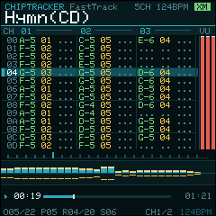

---

## What it is

Chiptracker plays tracker music with **libopenmpt 0.8.10** — the same engine that
powers OpenMPT — so XM/IT/MOD/S3M/MO3 files sound the way the authors intended.

It is not an emulator of console sound chips: it is a proper module player with a
tracker-style UI, built for a 240 × 240 screen and a D-pad.

## Features

- **Real tracker engine** — libopenmpt 0.8.10 (OpenMPT), ~30 module formats.
- **Pattern screen** — 3 channels per page, page carousel, VU meters, spectrum,
  marquee title, transport and status line.
- **8 fullscreen visualizers** — SPECTRUM, RADIAL (a vinyl turntable), SCOPE,
  WATERFALL, PLASMA, TUNNEL, STARS and a fullscreen PATTERN view. Each has two
  parameters on the D-pad: right for the main setting, left for a second one
  (mode / effect / spin).
- **Bottom visualizers** — SPECTRUM, SCOPE, mini WATERFALL, PEAKS, DOTS or OFF.
- **Screen lock** for your pocket: the music keeps playing, the panel goes black
  and the backlight is driven to its minimum. Lock with START, SELECT or **both
  at once**; unlock with the same gesture.
- **Battery & stats overlay** — press **Select (Fn)** to see FPS, position,
  library state and the battery percentage.
- **6 colour themes** — TEAL (blue RG Nano), BLACK, PURPLE, RED, SILVER, GAME BOY.
- **Grouped settings** — LIBRARY / PLAYBACK / DISPLAY / ANIMATION / SYSTEM, with a
  short explanation for every row (hold **L/R**), saved automatically.
- **Library that stays put** — pick a track and keep browsing; B returns to the
  player.
- **Resume, repeat, shuffle, quality, sample rate, FPS 15/30/45/60, CRT scanlines.**

## Screenshots

| Player | Library |
|---|---|
|  | 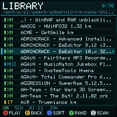 |

| Track info | Settings |
|---|---|
| 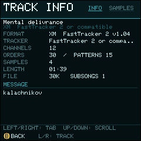 | 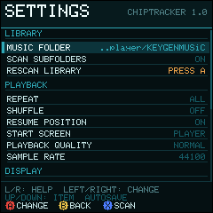 |

| System settings | Stats overlay (Select) |
|---|---|
| 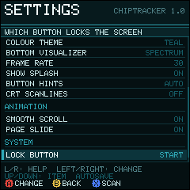 | 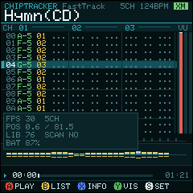 |

| Screen lock | Splash |
|---|---|
| 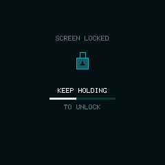 | 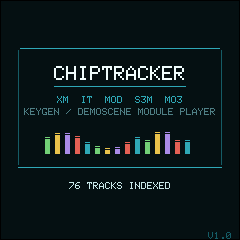 |

### Fullscreen visualizers

| Spectrum | Waterfall |
|---|---|
| 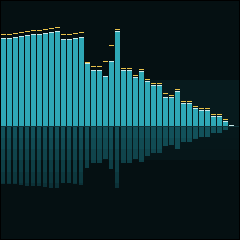 | 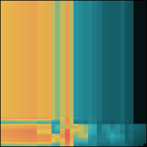 |

| Plasma | Tunnel |
|---|---|
| 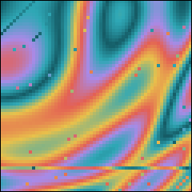 | 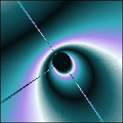 |

| Stars | Pattern |
|---|---|
|  | 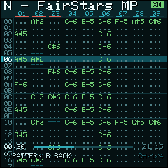 |

| Radial (vinyl) | Spectrum + sakura effect |
|---|---|
| 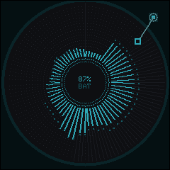 | 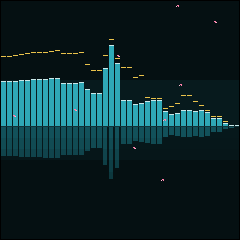 |

## Supported formats

Everything libopenmpt can read, including:

`XM` `IT` `MOD` `S3M` `MO3` `669` `AMF` `AMS` `DBM` `DMF` `DSM` `FAR` `GDM`
`IMF` `ITP` `J2B` `MDL` `MED` `MTM` `OKT` `PLM` `PSM` `PTM` `STM` `STX` `ULT`
`UMX` and more.

MO3 files with MP3-compressed samples work too (libmpg123 is bundled in the OPK).
Console sound formats such as NSF/SPC/GBS/VGM/SID are not supported — those are
chip emulators, not tracker modules.

## Where to find music

Chiptracker does not include any music. A great place to start is
**[keygenmusic.tk](https://keygenmusic.tk/)** — a large archive of keygen and
demoscene tracker modules (XM, IT, MOD, S3M, MO3 and more). You can also browse
[The Mod Archive](https://modarchive.org/).

## Controls

### Player

| Button | Action |
|---|---|
| D-pad ↑ / ↓ | previous / next order (instant) |
| D-pad ← / → | previous / next channel page (slide) |
| A | play / pause |
| B | library |
| X | track info |
| Y | fullscreen visualizer |
| L / R (shoulders) | previous / next track |
| Start | settings |
| Hold Start / Select / Both | lock the screen (see below) |
| Select (Fn) | stats overlay (FPS, position, battery) |
| Menu | exit |

### Library

| Button | Action |
|---|---|
| A | play the selected track and stay in the list |
| B | back to the player |
| X | sort: name → format → size |
| Y | random track |
| Start | rescan the music folder |
| L / R | page up / down |
| D-pad | select |

### Track info

`B` back · `D-pad ←/→` INFO / SAMPLES tabs · `↑/↓` scroll ·
`L/R` previous / next track without leaving the screen.

### Visualizer

| Button | Action |
|---|---|
| Y | next style |
| A | play / pause |
| B | back to the player |
| L / R | previous / next track |
| ↑ / ↓ | previous / next order |
| ← / → | second / first style parameter |
| X | track info |
| Start | settings |

### Settings

`↑/↓` item · `←/→` change · `A` change/open · `L/R` help for the selected
item · `B` back · `X` rescan.

## Screen lock

1. Choose the gesture in **SYSTEM → LOCK BUTTON**: `START`, `SELECT` or `BOTH`
   (both buttons pressed together).
2. Hold it for ~0.7 s: **`LOCKING...`** fades in, then the screen goes black.
3. A press of the same gesture shows a dim hint (progress starts from zero).
   Hold it for 1.5 s to unlock; with `BOTH` both buttons are required again.
4. The music keeps playing the whole time.

On the RG Nano panel used for development, a **full backlight cut-off is not
possible** — brightness 0, `bl_power` and the minimum level look the same. The app
therefore drives the backlight to its minimum and fills the screen black; the music
and the battery life benefit from the black screen and the dim panel.
Diagnostics are written to `lock.log` next to `config.ini`.

## Installation

1. Download **`chiptracker-1.0.opk`** from the
   [Releases](https://github.com/TemmieDola/chiptracker/releases) page.
2. Connect the RG Nano over USB and copy the `.opk` to the SD card:
   - RetroFE: the `Native games` folder (or the folder you launch games from);
   - GMenu2X: a first-level folder that contains an `apps` subfolder.
3. Unplug and launch **Chiptracker** from the menu.

On first start, pick the folder with your modules. It is remembered and scanned on
every start; **Start** in the library rescans it.

## Configuration

Settings are stored in `/mnt/FunKey/ChiptunePlayer/config.ini` and saved
automatically. The file is plain text, so it can be edited by hand.

## Building from source

Requirements:

- Linux or WSL (Ubuntu 22.04+)
- **FunKey SDK 2.3.0** (ARMv7 + musl toolchain, SDL 1.2)
- `squashfs-tools`, `python3` + Pillow (only for screenshots)
- `make`, `autotools` (for libopenmpt)

```bash
bash scripts/setup-sdk.sh     # downloads the SDK to ~/FunKey-sdk-2.3.0
APP=chiptune bash scripts/build.sh
# -> dist/chiptune.opk
```

The first build also cross-compiles libopenmpt into `vendor/` (a few minutes); it is
cached afterwards. On Windows, `build.ps1` runs the same script inside WSL:

```powershell
powershell -ExecutionPolicy Bypass -File .\build.ps1
```

Useful scripts:

- `scripts/gen-screenshots.sh` — regenerate `docs/` from the ARM build under qemu;
- `scripts/smoke-test.sh`, `scripts/stability.sh`, `scripts/test-modules.sh` — tests.

## Project layout

```
chiptune/          C sources (C99, SDL 1.2)
  opk/             launcher .desktop, icon, readme, third-party licences
scripts/           build, SDK setup, screenshots, tests
docs/              screenshots used in this README
vendor/            libopenmpt build script and headers (generated, not committed)
```

## Credits

- **[libopenmpt](https://lib.openmpt.org/)** / OpenMPT — BSD-3-Clause.
- **libmpg123** — LGPL-2.1 (bundled in the OPK for MO3 MP3 samples).
- **FunKey SDK / FunKey-OS** and **SDL 1.2** — the platform and toolchain.
- Fonts generated from the classic 5×7 GLCDFont and GNU Unifont.

The keygen music used while testing is **not** part of the repository.

## License

The Chiptracker source code is released under the **MIT License** — see
[LICENSE](LICENSE). Third-party component licences are included in the OPK
(`LICENSE.txt`, `LICENSE.mpg123.txt`).
